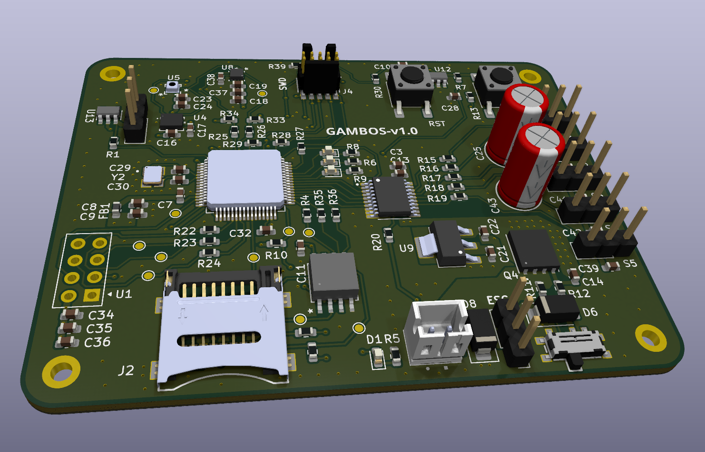

# Gambos flight controller — hardware

KiCad design of the **Gambos** STM32F446 flight-controller PCB. Firmware lives in [Gambos-Flight-Controller](https://github.com/mikaelmarvin/Gambos-Flight-Controller).

  

## Schematic (v1.0)

**[Gambos PCB schematic (PDF)](docs/gambos-pcb.pdf)** — KiCad export of the v1.0 board.

## Documentation (v1.0)

Subsystem pages (read in order; each links to the next):

1. [Hardware architecture](docs/hardware-architecture.md) — buses, actuation, debug interfaces
2. [Physical design](docs/physical-design.md) — stackup, dimensions, PCB layout
3. [Power](docs/power.md) — input switching, LDO, servo rail
4. [Storage](docs/storage.md) — external flash and microSD
5. [Sensing](docs/sensing.md) — IMU, magnetometer, barometer
6. [User interface](docs/user-interface.md) — RF module, button, LEDs
7. [Roadmap](docs/roadmap.md) — v1.0 open work and planned next hardware iterations

## Repository layout

| Path | Purpose |
| --- | --- |
| `gambos-pcb.kicad_pro` | KiCad project (schematic sheets `*.kicad_sch`, layout `gambos-pcb.kicad_pcb`) |
| `libs/` | Project symbol, footprint and 3D-model libraries |
| `gerbers/` | Manufacturing outputs |
| `docs/` | Hardware documentation, schematic PDF, figures |
